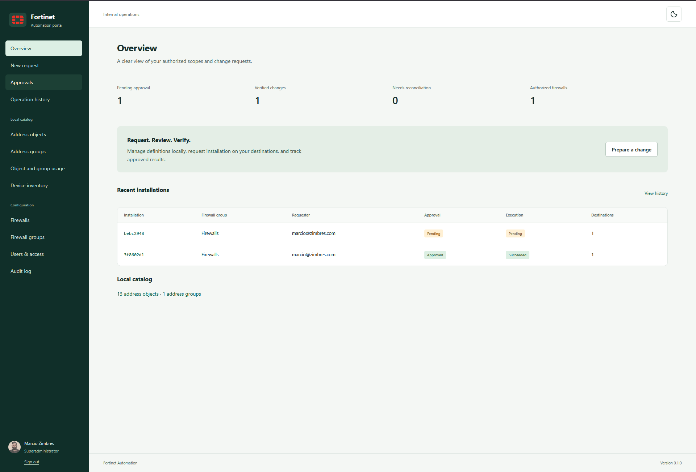
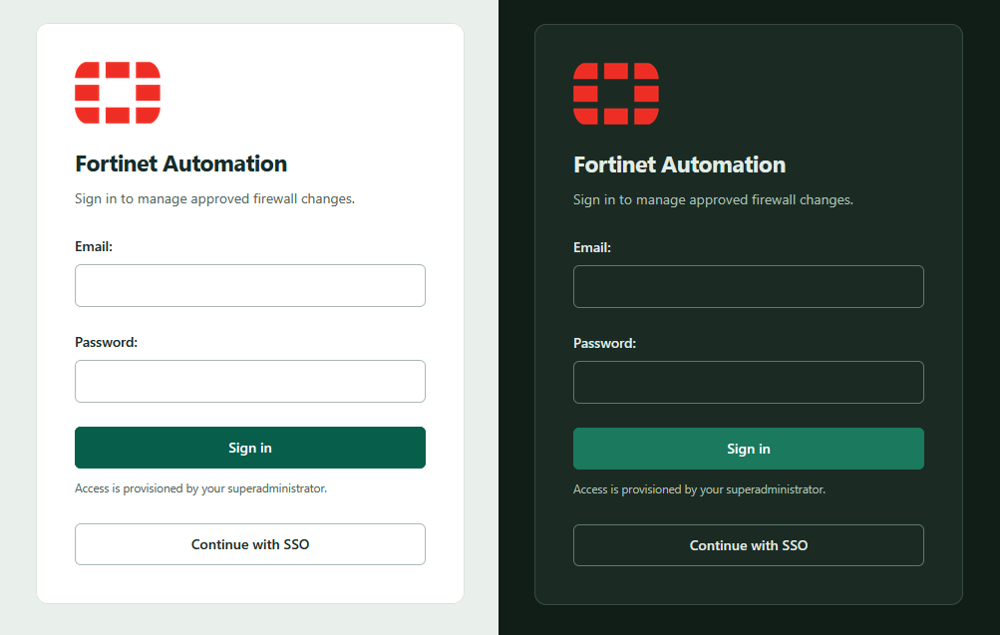
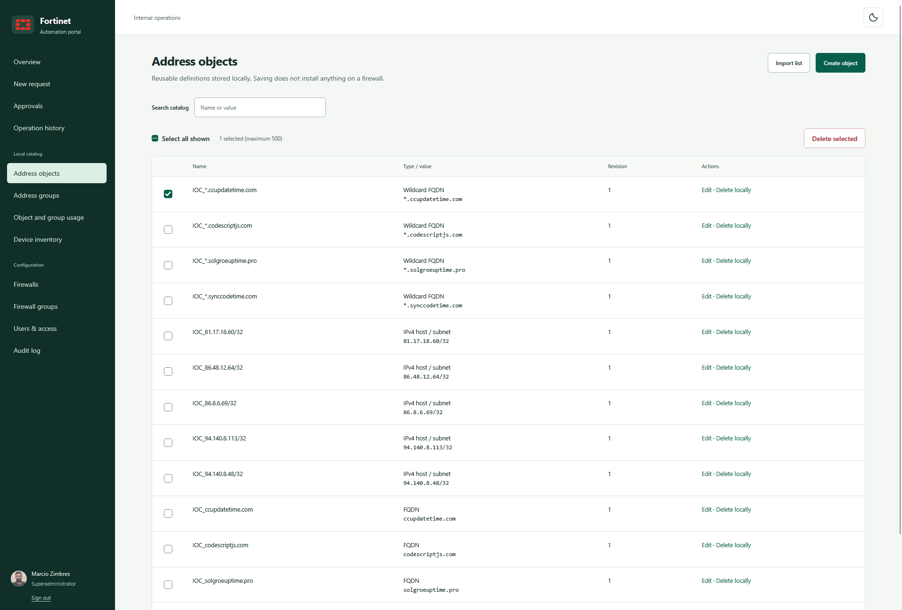
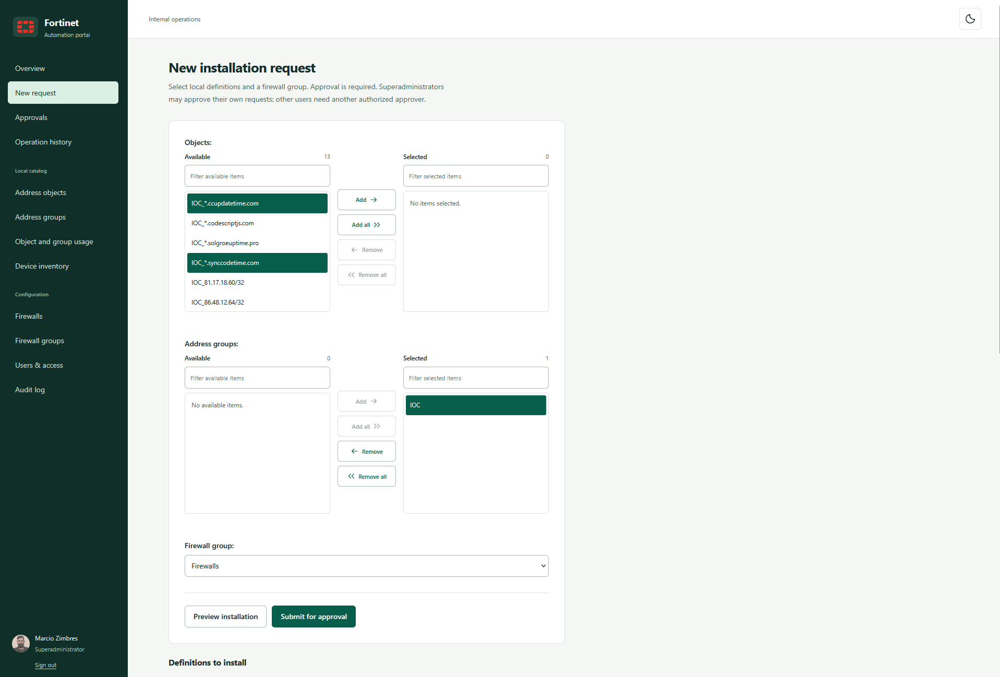
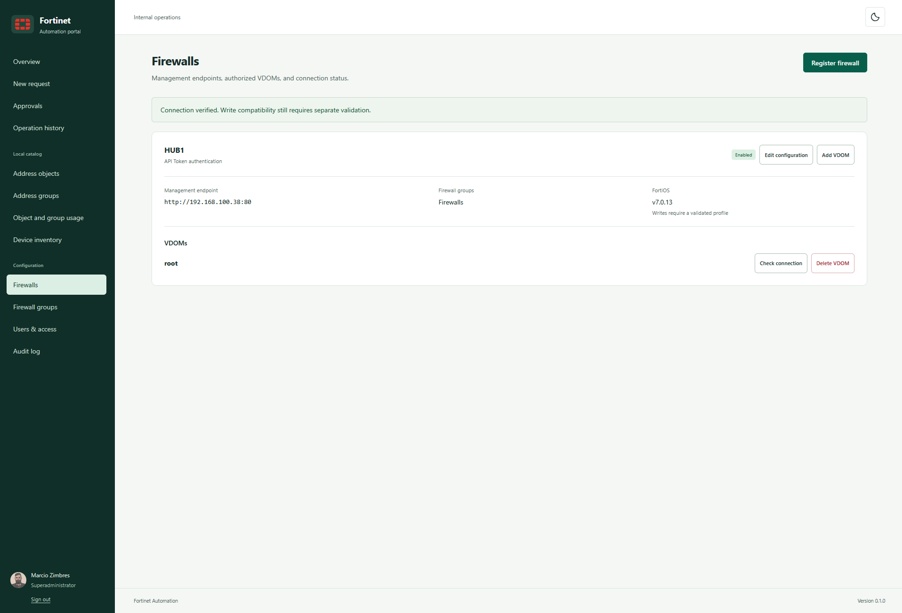
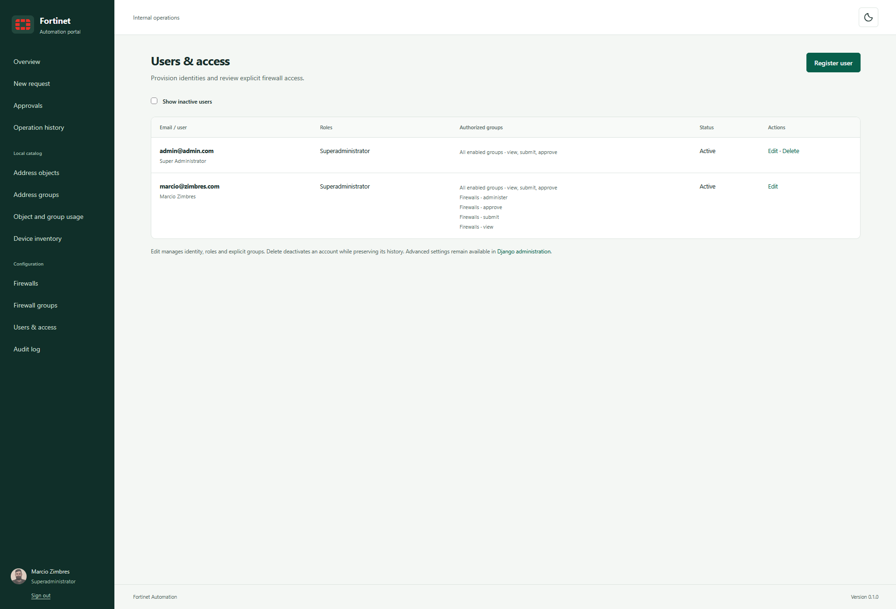
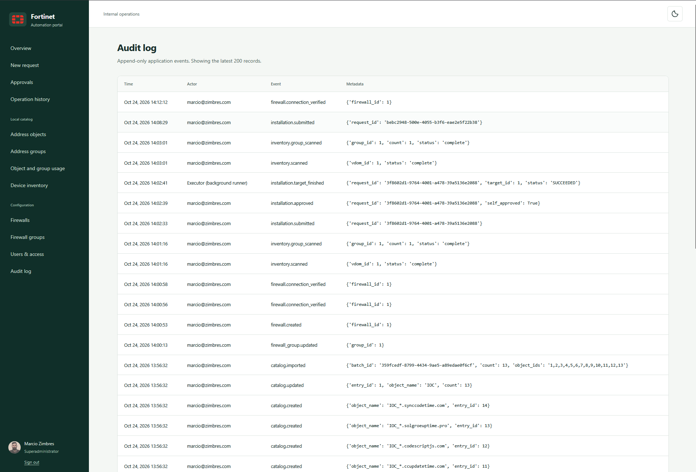

# Fortinet Automation Portal

The portal lets authorized people without direct firewall access add IP addresses and FQDNs to an existing address group already used by firewall rules. For example, a security team can submit malicious indicators quickly to a preconfigured block group without receiving firewall credentials. Each indicator is an address object; the address group collects those objects for the existing policy. Firewall administrators must configure and verify that policy first: adding group members does not create a deny rule or change policy order.

Address objects and address groups are stored in a local catalog. Catalog edits and bulk CSV imports need no approval; creating address groups is restricted to Administrators with Catalog Manage access and Superadministrators; every firewall belongs to at least one group, user device permissions are granted to groups, and installation requests target a named firewall group and require approval. Superadministrators may approve their own requests; other users need another authorized approver. See [the catalog and installation guide](docs/local-catalog.md).

## Portal walkthrough

The overview brings together authorized scopes, pending approvals, and execution results.



<details>
<summary>Sign in with a local account or SSO</summary>

Local email/password and SSO sign-in, shown in light and dark themes. Access is provisioned by a superadministrator.



</details>

<details>
<summary>Prepare address objects</summary>

Create or import IP/FQDN indicators into the local catalog and add them to an existing address group. Search by name or value; catalog changes alone do not change a firewall.



</details>

<details>
<summary>Submit an installation request</summary>

Select local objects, address groups, and an authorized firewall group, then preview the installation and submit it for approval.



</details>

<details>
<summary>Manage firewall connections</summary>

Administrators manage device endpoints, VDOMs, and connection checks. A successful connection check does not by itself establish write compatibility.



</details>

<details>
<summary>Provision users and access</summary>

Superadministrators provision accounts and assign explicit firewall-group permissions. Ordinary role labels alone do not grant access; address-group creation additionally requires Administrator access and Catalog Manage permission, or superadministrator status.



</details>

<details>
<summary>Review the audit trail</summary>

Trace submissions, approvals, catalog edits, and execution outcomes. Automated execution is identified as **Executor (background runner)** while requests retain their accountable requester and approver.



</details>

## Development status

The portal includes scoped access, superadministrator user provisioning, encrypted firewall registration, address/group inventory, immutable change requests, independent approval, an approval-controlled executor, reconciliation, usage scans, and application audit history. The interface and documentation are in English.

Real firewall writes require a validated device/operation profile. The HTTP 192.168.100.38:80/root/v7.0.13 scope has live validation for IPv4, FQDN, wildcard FQDN, and address-group writes; other device scopes remain blocked. Deletion also requires authoritative reference inspection, which is intentionally unavailable. OIDC must be validated with the target identity provider. This is a locally tested implementation, not a production deployment certification.

See [the approved design](docs/superpowers/specs/2026-10-22-fortinet-portal-design.md), [implementation plan](docs/superpowers/plans/2026-10-22-fortinet-portal.md), and [execution ledger](docs/development-ledger.md).

## Local setup

Use Python 3.14.9 and Node.js 26.12.1 / npm 12.2.1. For a fresh checkout install Python 3.14 and Node first. From a network-enabled PowerShell terminal:

```powershell
py -3.14 -m venv .venv
.venv/Scripts/python.exe -m pip install -c requirements.lock -e '.[test]'
npm ci
npm run build
.venv/Scripts/python.exe -m pytest -q
```

Initial accounts and audit migrations are included. Apply migrations and create an administrator before signing in:

```powershell
.venv/Scripts/python.exe manage.py migrate
.venv/Scripts/python.exe manage.py check
.venv/Scripts/python.exe manage.py create_encryption_key
.venv/Scripts/python.exe manage.py createsuperuser
.venv/Scripts/python.exe manage.py runserver 127.0.0.1:8000
```

Open the portal at [localhost:8000](http://127.0.0.1:8000/). Start `.venv/Scripts/python.exe manage.py run_executor` in a separate terminal. Django administration remains available at `/admin/` for existing account and scope-grant maintenance. There are no default credentials. Do not overwrite an existing encryption key file.

See [operations](docs/operations.md), [deployment](docs/deployment.md), [backup/restore](docs/backup-restore.md), [testing](docs/testing.md), and [security boundaries](docs/security.md). The production Compose stack runs Gunicorn and exactly one executor in the same non-root application container, with both logs on stdout. An unprivileged Nginx container serves HTTPS. Use `docker compose logs -f web` to watch both services. Development settings are only for localhost.
