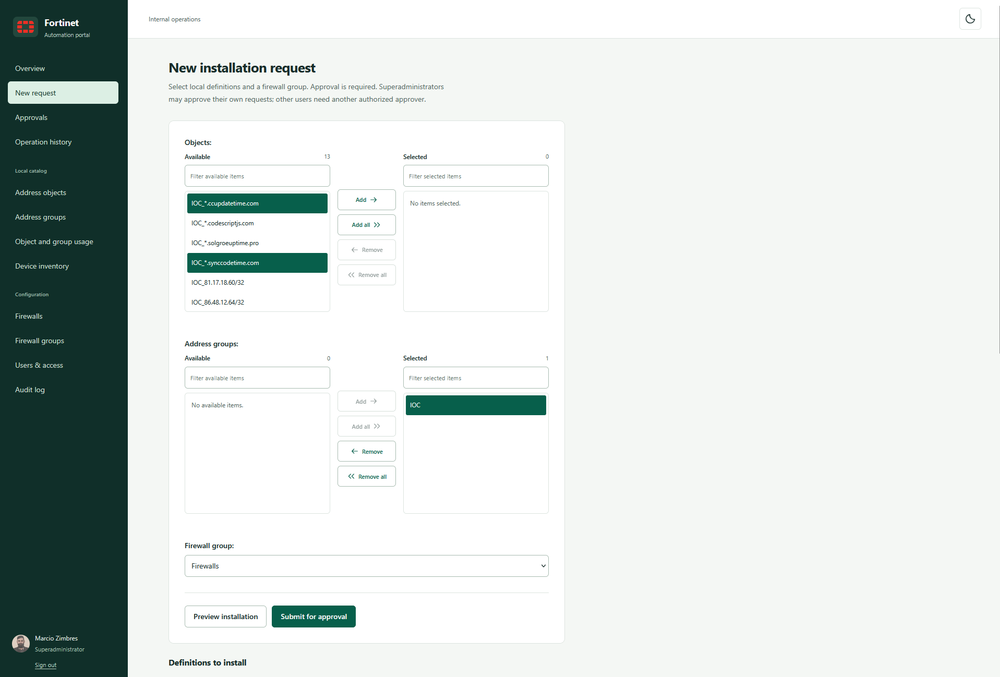
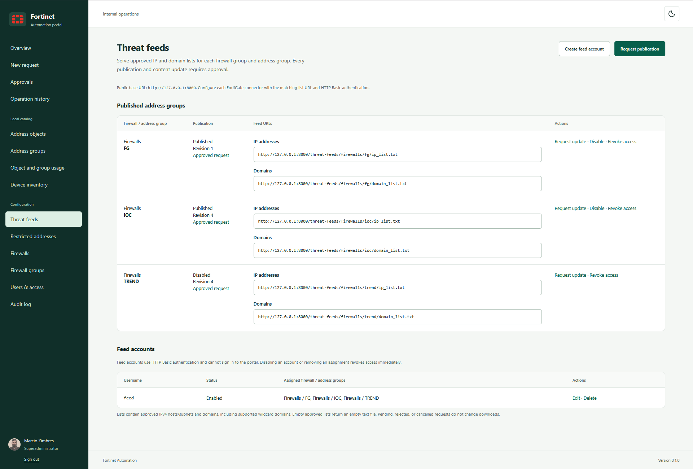
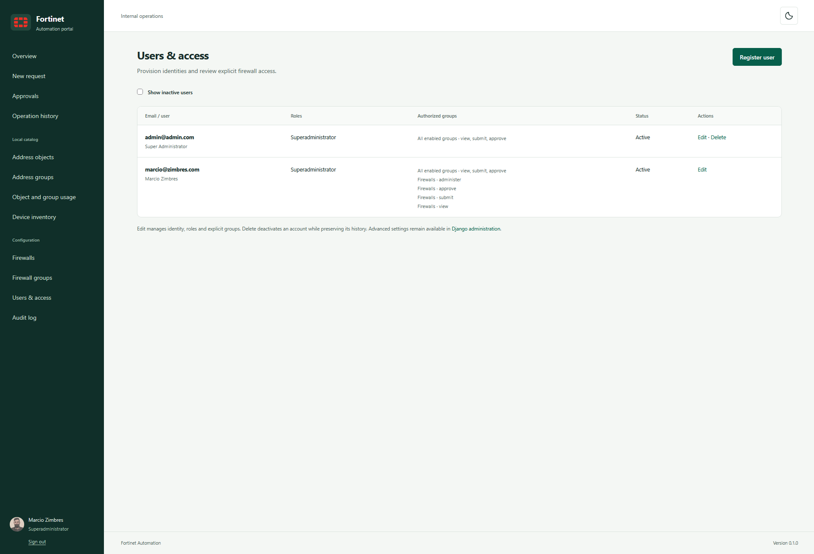
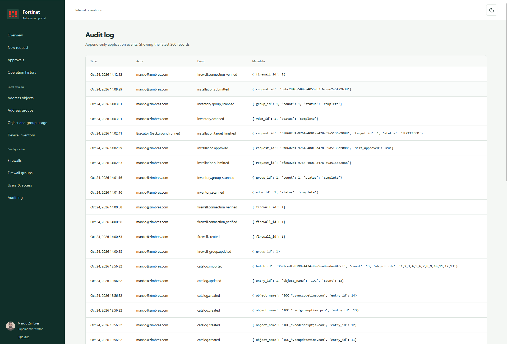

# Fortinet Automation Portal

The portal lets authorized people without direct firewall access add IP addresses and FQDNs to an existing address group already used by firewall rules. For example, a security team can submit malicious indicators quickly to a preconfigured block group without receiving firewall credentials. Each indicator is an address object; the address group collects those objects for the existing policy. Firewall administrators must configure and verify that policy first: adding group members does not create a deny rule or change policy order.

Address objects and address groups are stored in a local catalog. Catalog edits and bulk CSV imports need no approval; creating address groups is restricted to Administrators with Catalog Manage access and Superadministrators; every firewall belongs to at least one group, user device permissions are granted to groups, and installation requests target a named firewall group and require approval. Superadministrators may approve their own requests; other users need another authorized approver. See [the catalog and installation guide](docs/local-catalog.md).

## Portal walkthrough

The overview brings together authorized scopes, pending approvals, and execution results.


<details>
<summary>Sign in with a local account or SSO</summary>

Local email/password and SSO sign-in, shown in light and dark themes. Access is provisioned by a superadministrator.


</details>

<details>
<summary>Prepare address objects</summary>

Create or import IP/FQDN indicators into the local catalog and add them to an existing address group. Search by name or value; catalog changes alone do not change a firewall.


</details>

<details>
<summary>Submit an installation request</summary>

Select local objects, address groups, and an authorized firewall group, then preview the installation and submit it for approval.



</details>

<details>
<summary>Publish approved Threat Feeds</summary>

Publish approved IP and domain lists for each firewall group and address group. View publication status and revision, copy the feed URLs, request updates, and manage the feed accounts explicitly assigned to each publication.



</details>

<details>
<summary>Manage firewall connections</summary>

Administrators manage device endpoints, VDOMs, and connection checks. A successful connection check does not by itself establish write compatibility.


</details>

<details>
<summary>Provision users and access</summary>

Superadministrators provision accounts and assign explicit firewall-group permissions. Ordinary role labels alone do not grant access; address-group creation additionally requires Administrator access and Catalog Manage permission, or superadministrator status.



</details>

<details>
<summary>Review the audit trail</summary>

Trace submissions, approvals, catalog edits, and execution outcomes. Automated execution is identified as **Executor (background runner)** while requests retain their accountable requester and approver.



</details>

## Development status

The portal includes scoped access, superadministrator user provisioning, encrypted firewall registration, address/group inventory, immutable change requests, independent approval, an approval-controlled executor, reconciliation, usage scans, and application audit history. The interface and documentation are in English.

Real firewall writes require a validated device/operation profile. The HTTP 192.168.100.38:80/root/v7.0.13 scope has live validation for IPv4, FQDN, wildcard FQDN, and address-group writes; other device scopes remain blocked. Deletion also requires authoritative reference inspection, which is intentionally unavailable. OIDC must be validated with the target identity provider. This is a locally tested implementation, not a production deployment certification.

See [the approved design](docs/superpowers/specs/2026-10-22-fortinet-portal-design.md), [implementation plan](docs/superpowers/plans/2026-10-22-fortinet-portal.md), and [execution ledger](docs/development-ledger.md).

## Threat feeds

Active Administrators and Superadministrators submit **New request → Target: Threat Feeds**, selecting a firewall group and one or more address groups (clear standalone objects). Preview the exact IP/domain content and URLs, then submit for approval. Every initial publication and content update requires explicit approval using the existing firewall-group approval permissions; Superadministrators retain their existing explicit self-approval option. The normal executor publishes approved requests locally without contacting FortiGate. For local development, run `.venv/Scripts/python.exe manage.py run_executor` alongside `runserver`.

Feeds serve only the last successfully approved snapshot. Catalog edits and pending, rejected or cancelled requests never change published content. Older requests fail if a publication changed or was revoked after submission. Resubmit a new request in that case. Each request publishes all selected groups atomically. Source groups referenced by publications are protected from deletion; member objects may still be edited through the catalog without changing approved text.

URLs include both groups, for example `https://portal.example.com/threat-feeds/hq_firewalls/ioc/ip_list.txt` and `domain_list.txt`. One address group may have independent approved versions in different firewall groups. Slugs remain stable after renames. Lists contain one indicator per line: the catalog's IPv4 hosts/subnets, FQDNs and supported wildcard FQDNs. Empty approved lists return an empty text file; IPv6, IP ranges and other wildcard formats require future catalog support.

Set `APP_PUBLIC_URL` in the process environment (Compose forwards it). Unset or empty values default to `http://127.0.0.1:8000`. The configuration and request pages show complete URLs using that base, including an optional deployment prefix configured on your reverse proxy. Direct Django commands do not automatically load `.env`. Restart the app when changing environment values.

In **Configuration → Threat feeds**, create separate feed accounts and explicitly assign each approved firewall-group/address-group publication. Configure FortiGate connectors with the matching URL and HTTP Basic credentials. An assignment never grants access to another firewall group's version. Passwords are hashed, cannot be viewed later, and can be replaced by editing the account. Feed accounts cannot sign in to the portal; portal users/sessions cannot authenticate downloads. Use HTTPS in production.

Disabling an account/publication or firewall group, removing an account assignment, or revoking publication access stops downloads immediately. Republishing a disabled/revoked feed requires a new approved request. Revocation retains its revision history and clears account assignments; disabling alone preserves assignments. Publication, approval, credential configuration and revocation changes are audited without passwords.

Use **Request update** on a published feed to open its fixed firewall-group/address-group scope. Preview and approval details show only added/removed IPs and domains, or a publication-state change. Unchanged values and unchanged feeds are excluded; requests with no changes are refused. Standalone object controls are unavailable for the Threat Feeds target. Approved full snapshots are still stored and published atomically. Feed records without a firewall-group scope are removed by the cleanup migration; accounts, catalog entries and approved history remain.

### How the Threat Feed implementation works

The implementation connects the local catalog to an approved, versioned publication. Its lifecycle is:

```text
Address-group members → Request snapshot → Approval → Executor → Stored feed text → Authenticated download
```

1. **Prepare the proposed content.** The requester selects a firewall group and address groups. The backend reads each group's members, separates IPv4 hosts/subnets from domains, removes duplicates and sorts the values. It compares the proposed lists with the currently published lists and records additions, removals and any enable-publication action. Groups with no changes are excluded; an entirely unchanged request is refused.
2. **Capture the request.** Submission stores the complete proposed content, the displayed changes, source catalog revisions, stable URL identifiers and the current publication revision in an immutable snapshot. A digest protects that intent. URL identities are reserved at submission so separate pending requests cannot claim the same URL for different groups. Previewing alone does not reserve identities or publish anything.
3. **Obtain approval.** The normal approval workflow checks the selected firewall group's permissions. Submission does not automatically approve or publish, including for Superadministrators. Their existing self-approval permission requires an explicit approval action. Pending, rejected and cancelled requests leave the current feed available.
4. **Publish through the executor.** The executor rechecks approval, snapshot integrity and requester/approver access. It also checks that the publication revision still matches the version captured at submission. If another request published or an administrator revoked access in the meantime, the stale request fails and must be resubmitted. All groups in one request publish in a single database transaction, together with successful request completion. No FortiGate API call is involved.
5. **Serve the approved version.** A connector downloads the stored IP or domain text using a separately provisioned feed account. Each download checks that account's password, active state and assignment to the exact firewall-group/address-group publication. It also checks publication availability and the firewall group's enabled state. Catalog edits never change this stored version without another approved request.

#### Data stored for feeds

The [inventory models](apps/inventory/models.py) separate URL identity, published content and connector credentials:

| Model | Responsibility |
|---|---|
| `ThreatFeedScope` | Associates a firewall group with its persistent URL slug. Renaming the firewall group does not change existing URLs. |
| `ThreatFeedIdentity` | Reserves an address group's slug within a scope, including while requests await approval. A reservation contains no downloadable content and grants no access. |
| `ThreatFeed` | Stores the scoped address-group publication: approved IP/domain text, revision, enabled state and the request that successfully published it. |
| `FeedAccount` | Stores a separate connector username, hashed password, active state and explicit publication assignments. It is not a portal `User` and cannot establish a portal session. |
| `InstallationRequest` | Stores submitted intent, its digest, requester, approver, approval/execution states and errors. Feed requests use `snapshot.target_kind = "threat_feeds"` and have no device destinations. |

#### Main functions and their responsibilities

| Function | What it does |
|---|---|
| [`require_feed_request_permission()`](apps/changes/feed_publications.py) | Checks view and requested capability on the firewall group. Submission additionally requires feed-management privileges and catalog-view access. |
| [`prepare_feed_scope()`](apps/changes/feed_publications.py) | Creates or reuses the firewall group's stable namespace during submission. This does not publish a feed. |
| [`build_feed_snapshot()`](apps/changes/feed_publications.py) | Validates the selected address groups, rejects standalone objects, produces normalized IP/domain lists and captures their changes against the published version. Returns the full proposed snapshot, excluding unchanged feeds. |
| [`reserve_feed_identities()`](apps/changes/feed_publications.py) | Persists the exact scoped slugs captured by the request, preventing collisions between pending requests. A conflicting concurrent reservation requires a fresh preview. |
| [`submit_installation()`](apps/changes/installations.py) | Captures and validates the immutable snapshot, checks the submission key for duplicate/different intent, reserves feed identities and creates a pending approval request with an audit event. |
| [`decide_installation()`](apps/changes/installations.py) | Applies an authorized approve, reject or cancel decision. Checks request state and current group permissions; approval itself does not replace published content. |
| [`execute_next_installation()`](apps/changes/installation_executor.py) | Claims an approved pending request and dispatches the Threat Feeds target to local publication instead of the firewall installation path. |
| [`execute_feed_request()`](apps/changes/feed_publications.py) | Verifies approved intent and access, rejects stale publication revisions, writes the approved text atomically, increments revisions and records execution results. Failed local transactions leave the previous content intact. |
| [`feed_snapshot_urls()`](apps/changes/feed_publications.py) | Adds display URLs, counts and captured changes to request previews/details. The public deployment URL is presentation data and is not embedded in approved intent. |
| [`new_installation()` and `InstallationForm`](apps/portal/installation_views.py) | Handle preview and submission. An existing-feed update binds to that feed, locks both groups and rejects a stale update-screen revision. The [form validation](apps/changes/forms.py) also rejects forged standalone-object selections for Threat Feeds. |
| [`download()`](apps/portal/threat_feed_views.py) | Processes Basic authentication and scoped authorization, then returns the stored IP or domain text. Supports GET and HEAD and prevents response caching. |
| [`save_feed_account()`](apps/inventory/threat_feeds.py) | Creates or edits connector credentials, validates and hashes a replacement password, replaces explicit assignments and audits the configuration without logging passwords. A blank password on edit keeps the existing hash. |
| [`disable_feed()`](apps/inventory/threat_feeds.py) | Stops downloads and increments the revision so requests submitted before the disable cannot silently re-enable the publication. A new approved request is required. |
| [`delete_feed_configuration()`](apps/inventory/threat_feeds.py) | Deletes a feed account when requested. For publication revocation, it disables the publication and clears account assignments while retaining the publication's revision record. |
| [`normalize_public_url()`](config/public_url.py) | Validates the configured HTTP/HTTPS base URL and optional path prefix, rejects embedded credentials/query/fragment, removes trailing slashes and supplies the localhost default when unset or empty. |

#### Updating an existing feed

**Request update** opens the specific feed with the firewall group and address group fixed. Its preview and approval details display only changes captured for that request. Standalone object controls are unavailable for this target, and server validation enforces the same rule.

For example, if the published IP list contains `192.0.2.1/32` and the catalog group now contains `192.0.2.2/32`, the update shows:

```text
Added IP addresses:   192.0.2.2/32
Removed IP addresses: 192.0.2.1/32
```

An unchanged domain list is omitted from the change preview but remains in the complete approved snapshot. After approval and successful execution, the IP list changes and the unchanged domains remain. Editing the catalog again after submission does not rewrite the submitted changes. A disabled publication can also produce an explicit **Enable publication** change even when its indicator values are unchanged.

#### Download behavior and troubleshooting

The [download routes](config/urls.py) identify both scopes:

```text
GET /threat-feeds/<firewall-group>/<address-group>/ip_list.txt
GET /threat-feeds/<firewall-group>/<address-group>/domain_list.txt
```

| Result | Meaning |
|---|---|
| `200` | Authentication and assignment checks passed; the response contains the stored approved text. An approved empty list has an empty body. |
| `401` | Basic credentials are missing/invalid, or the feed account is inactive. The response includes a Basic authentication challenge. Portal login credentials or a browser session do not substitute for feed credentials. |
| `404` | The requested publication is unavailable, disabled or outside the account's assignments, its firewall group is disabled, or the requested file/path does not exist. |
| `405` | The client used a method other than GET or HEAD. |

If approval succeeds but the feed has not updated, check that `manage.py run_executor` is running and inspect the request's execution status. An execution failure reporting a changed publication means a newer revision or revocation invalidated the request; create a fresh request. A successful download that takes about a second may be dominated by password hashing: every download currently verifies Basic credentials with Django's configured hasher. Local measurements with PBKDF2-SHA256 at 1,500,000 iterations showed approximately 1.0–1.1 seconds for verification and milliseconds for database lookups. Authentication is not currently cached.

#### Verification and design records

Behavior is covered by [authentication/text-output tests](tests/test_threat_feeds.py), [approval/publication tests](tests/test_feed_approvals.py), [fixed-scope update and delta tests](tests/test_feed_update_ui.py), and [migration/data-preservation tests](tests/test_feed_approval_migration.py). The [cleanup migration](apps/inventory/migrations/0013_remove_unscoped_feeds.py) removes unsupported unscoped publications and their account links while preserving accounts, catalog entries, scoped publications and request history.

See the [approved design](docs/superpowers/specs/2026-11-15-approved-threat-feeds-design.md), [approval/scoping implementation record](docs/superpowers/plans/2026-11-15-approved-threat-feeds.md), and [update-screen/cleanup implementation record](docs/superpowers/plans/2026-11-15-feed-update-refinements.md) for the recorded decisions and validation.

## Local setup

Use Python 3.14.9 and Node.js 26.12.1 / npm 12.2.1. For a fresh checkout install Python 3.14 and Node first. From a network-enabled PowerShell terminal:

```powershell
py -3.14 -m venv .venv
.venv/Scripts/python.exe -m pip install -c requirements.lock -e '.[test]'
npm ci
npm run build
.venv/Scripts/python.exe -m pytest -q
```

Initial accounts and audit migrations are included. Apply migrations and create an administrator before signing in:

```powershell
.venv/Scripts/python.exe manage.py migrate
.venv/Scripts/python.exe manage.py check
.venv/Scripts/python.exe manage.py create_encryption_key
.venv/Scripts/python.exe manage.py createsuperuser
.venv/Scripts/python.exe manage.py runserver 127.0.0.1:8000
```

Open the portal at [localhost:8000](http://127.0.0.1:8000/). Start `.venv/Scripts/python.exe manage.py run_executor` in a separate terminal. Django administration remains available at `/admin/` for existing account and scope-grant maintenance. There are no default credentials. Do not overwrite an existing encryption key file.

See [operations](docs/operations.md), [deployment](docs/deployment.md), [backup/restore](docs/backup-restore.md), [testing](docs/testing.md), and [security boundaries](docs/security.md). The production Compose stack runs Gunicorn and exactly one executor in the same non-root application container, with both logs on stdout. An unprivileged Nginx container serves HTTPS. Use `docker compose logs -f web` to watch both services. Development settings are only for localhost.
