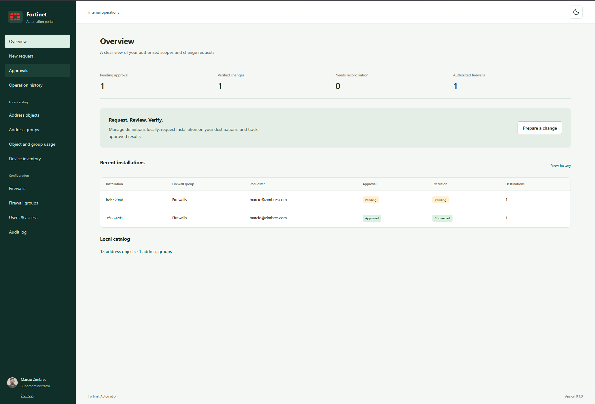
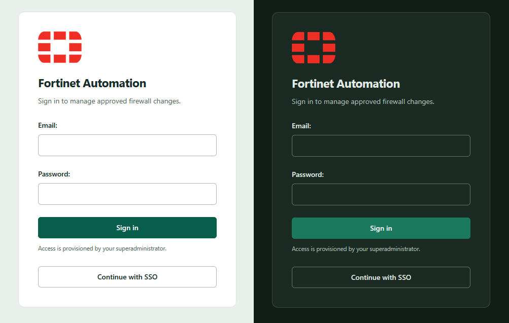
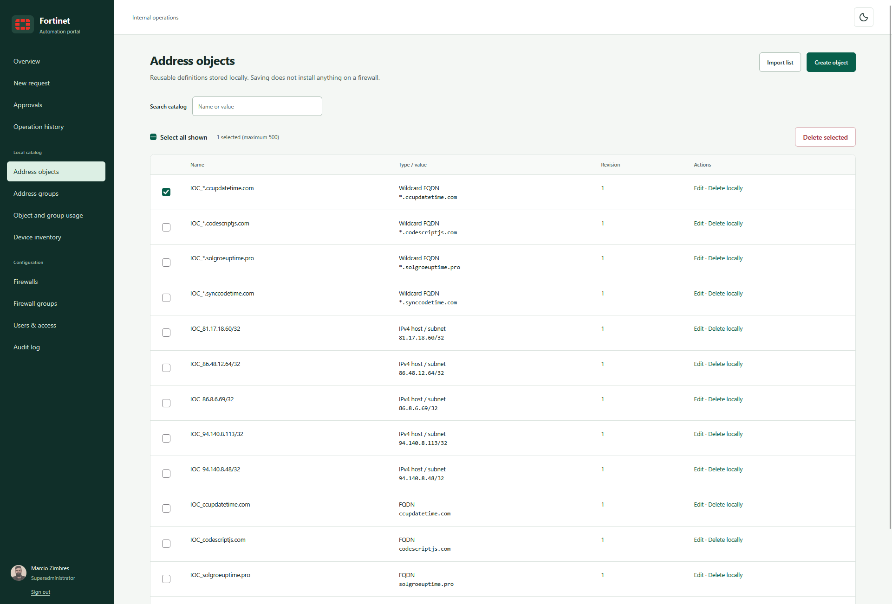
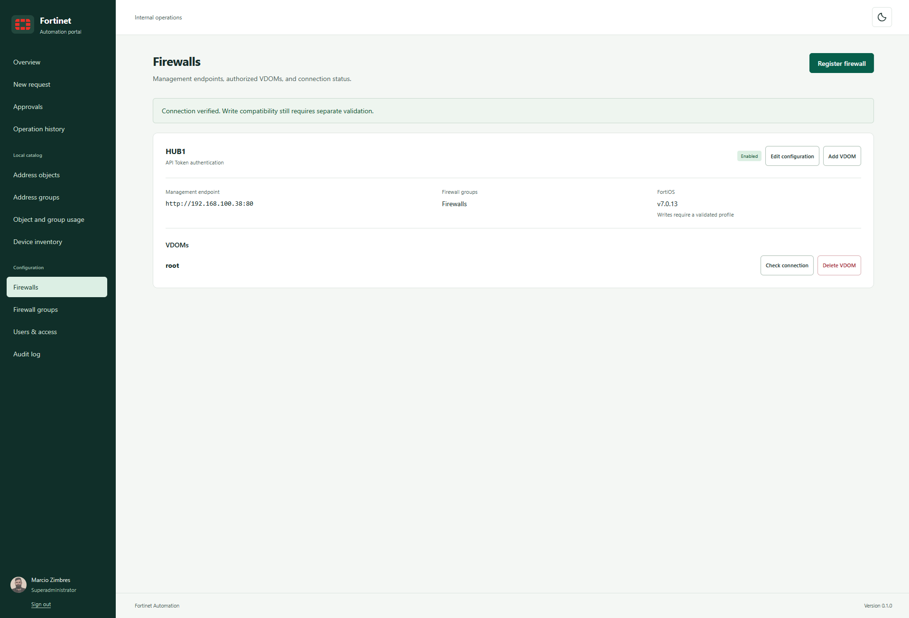

# Fortinet Automation Portal

The portal lets authorized people without direct firewall access add IP addresses and FQDNs to an existing address group already used by firewall rules. For example, a security team can submit malicious indicators quickly to a preconfigured block group without receiving firewall credentials. Each indicator is an address object; the address group collects those objects for the existing policy. Firewall administrators must configure and verify that policy first: adding group members does not create a deny rule or change policy order.

Address objects and address groups are stored in a local catalog. Catalog edits and bulk CSV imports need no approval; creating address groups is restricted to Administrators with Catalog Manage access and Superadministrators; every firewall belongs to at least one group, user device permissions are granted to groups, and installation requests target a named firewall group and require approval. Superadministrators may approve their own requests; other users need another authorized approver. See [the catalog and installation guide](docs/local-catalog.md).

## Portal walkthrough

The overview brings together authorized scopes, pending approvals, and execution results.



<details>
<summary>Sign in with a local account or SSO</summary>

Local email/password and SSO sign-in, shown in light and dark themes. Access is provisioned by a superadministrator.



</details>

<details>
<summary>Prepare address objects</summary>

Create or import IP/FQDN indicators into the local catalog and add them to an existing address group. Search by name or value; catalog changes alone do not change a firewall.



</details>

<details>
<summary>Submit an installation request</summary>

Select local objects, address groups, and an authorized firewall group, then preview the installation and submit it for approval.


</details>

<details>
<summary>Manage firewall connections</summary>

Administrators manage device endpoints, VDOMs, and connection checks. A successful connection check does not by itself establish write compatibility.



</details>

<details>
<summary>Provision users and access</summary>

Superadministrators provision accounts and assign explicit firewall-group permissions. Ordinary role labels alone do not grant access; address-group creation additionally requires Administrator access and Catalog Manage permission, or superadministrator status.


</details>

<details>
<summary>Review the audit trail</summary>

Trace submissions, approvals, catalog edits, and execution outcomes. Automated execution is identified as **Executor (background runner)** while requests retain their accountable requester and approver.


</details>

## Development status

The portal includes scoped access, superadministrator user provisioning, encrypted firewall registration, address/group inventory, immutable change requests, independent approval, an approval-controlled executor, reconciliation, usage scans, and application audit history. The interface and documentation are in English.

Real firewall writes require a validated device/operation profile. The HTTP 192.168.100.38:80/root/v7.0.13 scope has live validation for IPv4, FQDN, wildcard FQDN, and address-group writes; other device scopes remain blocked. Deletion also requires authoritative reference inspection, which is intentionally unavailable. OIDC must be validated with the target identity provider. This is a locally tested implementation, not a production deployment certification.

See [the approved design](docs/superpowers/specs/2026-10-22-fortinet-portal-design.md), [implementation plan](docs/superpowers/plans/2026-10-22-fortinet-portal.md), and [execution ledger](docs/development-ledger.md).

## Threat feeds

Active Administrators and Superadministrators submit **New request → Target: Threat Feeds**, selecting a firewall group and one or more address groups (clear standalone objects). Preview the exact IP/domain content and URLs, then submit for approval. Every initial publication and content update requires explicit approval using the existing firewall-group approval permissions; Superadministrators retain their existing explicit self-approval option. The normal executor publishes approved requests locally without contacting FortiGate. For local development, run `.venv/Scripts/python.exe manage.py run_executor` alongside `runserver`.

Feeds serve only the last successfully approved snapshot. Catalog edits and pending, rejected or cancelled requests never change published content. Older requests fail if a publication changed or was revoked after submission. Resubmit a new request in that case. Each request publishes all selected groups atomically. Source groups referenced by publications are protected from deletion; member objects may still be edited through the catalog without changing approved text.

URLs include both groups, for example `https://portal.example.com/threat-feeds/hq_firewalls/ioc/ip_list.txt` and `domain_list.txt`. One address group may have independent approved versions in different firewall groups. Slugs remain stable after renames. Lists contain one indicator per line: the catalog's IPv4 hosts/subnets, FQDNs and supported wildcard FQDNs. Empty approved lists return an empty text file; IPv6, IP ranges and other wildcard formats require future catalog support.

Set `APP_PUBLIC_URL` in the process environment (Compose forwards it). Unset or empty values default to `http://127.0.0.1:8000`. The configuration and request pages show complete URLs using that base, including an optional deployment prefix configured on your reverse proxy. Direct Django commands do not automatically load `.env`. Restart the app when changing environment values.

In **Configuration → Threat feeds**, create separate feed accounts and explicitly assign each approved firewall-group/address-group publication. Configure FortiGate connectors with the matching URL and HTTP Basic credentials. An assignment never grants access to another firewall group's version. Passwords are hashed, cannot be viewed later, and can be replaced by editing the account. Feed accounts cannot sign in to the portal; portal users/sessions cannot authenticate downloads. Use HTTPS in production.

Disabling an account/publication or firewall group, removing an account assignment, or revoking publication access stops downloads immediately. Republishing a disabled/revoked feed requires a new approved request. Revocation retains its revision history and clears account assignments; disabling alone preserves assignments. Publication, approval, credential configuration and revocation changes are audited without passwords.

Use **Request update** on a published feed to open its fixed firewall-group/address-group scope. Preview and approval details show only added/removed IPs and domains, or a publication-state change. Unchanged values and unchanged feeds are excluded; requests with no changes are refused. Standalone object controls are unavailable for the Threat Feeds target. Approved full snapshots are still stored and published atomically. Feed records without a firewall-group scope are removed by the cleanup migration; accounts, catalog entries and approved history remain.
### Threat Feed implementation references

- **Design and implementation record:** [approved publication design](docs/superpowers/specs/2026-11-15-approved-threat-feeds-design.md), [approval/scoping implementation plan](docs/superpowers/plans/2026-11-15-approved-threat-feeds.md), and [fixed update screens and cleanup](docs/superpowers/plans/2026-11-15-feed-update-refinements.md).
- **Requests and publication:** [snapshot, delta, URL reservation and atomic publication service](apps/changes/feed_publications.py), [shared submission and approval flow](apps/changes/installations.py), and [executor dispatch](apps/changes/installation_executor.py).
- **Downloads and access:** [Basic-auth download and management views](apps/portal/threat_feed_views.py), [feed-account permissions and revocation](apps/inventory/threat_feeds.py), and [account assignment forms](apps/inventory/threat_feed_forms.py).
- **Storage and routing:** [feed, scope, identity and account models](apps/inventory/models.py), [URL routes](config/urls.py), [public URL configuration](config/public_url.py), and [unscoped-feed cleanup migration](apps/inventory/migrations/0013_remove_unscoped_feeds.py).
- **Verification:** [authentication and text output tests](tests/test_threat_feeds.py), [approval and publication tests](tests/test_feed_approvals.py), [fixed-scope update and delta tests](tests/test_feed_update_ui.py), and [migration/data-preservation tests](tests/test_feed_approval_migration.py).

**Authentication performance:** every feed download currently verifies its Basic-auth password using Django's configured password hasher. With PBKDF2-SHA256 at 1,500,000 iterations, local measurements showed approximately 1.0–1.1 seconds for password verification, compared with milliseconds for database lookups. Downloads serve stored approved text; they do not regenerate lists from the catalog. Successful authentication is not currently cached.

## Local setup

Use Python 3.14.9 and Node.js 26.12.1 / npm 12.2.1. For a fresh checkout install Python 3.14 and Node first. From a network-enabled PowerShell terminal:

```powershell
py -3.14 -m venv .venv
.venv/Scripts/python.exe -m pip install -c requirements.lock -e '.[test]'
npm ci
npm run build
.venv/Scripts/python.exe -m pytest -q
```

Initial accounts and audit migrations are included. Apply migrations and create an administrator before signing in:

```powershell
.venv/Scripts/python.exe manage.py migrate
.venv/Scripts/python.exe manage.py check
.venv/Scripts/python.exe manage.py create_encryption_key
.venv/Scripts/python.exe manage.py createsuperuser
.venv/Scripts/python.exe manage.py runserver 127.0.0.1:8000
```

Open the portal at [localhost:8000](http://127.0.0.1:8000/). Start `.venv/Scripts/python.exe manage.py run_executor` in a separate terminal. Django administration remains available at `/admin/` for existing account and scope-grant maintenance. There are no default credentials. Do not overwrite an existing encryption key file.

See [operations](docs/operations.md), [deployment](docs/deployment.md), [backup/restore](docs/backup-restore.md), [testing](docs/testing.md), and [security boundaries](docs/security.md). The production Compose stack runs Gunicorn and exactly one executor in the same non-root application container, with both logs on stdout. An unprivileged Nginx container serves HTTPS. Use `docker compose logs -f web` to watch both services. Development settings are only for localhost.
